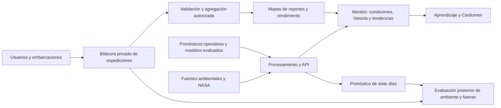

# Evolución de Chaski Polar hacia una plataforma para pesca artesanal

Fecha: 14 de noviembre de 2026. Guía panorámica de ejecución para el equipo.

Leer primero: [Propuesta de valor y paquetes](REPORTE_VISION_PESCA_ARTESANAL.md).

Este documento propone la evolución; no describe funcionalidades ya implementadas. Las referencias al código se comprobaron en la copia local. Las etapas son entregas con dependencias, no promesas de calendario.

## 1. Visión compartida

Chaski Polar combinará tres actividades: **consultar el mar, aprender a interpretar sus cambios y registrar lo que ocurrió en una faena**. El público inicial será la pesca artesanal peruana.

La experiencia cotidiana empieza por una zona y una pregunta. El pescador puede consultar información sin crear una cuenta ni jugar. Las cuentas aparecen cuando quiere guardar su embarcación y expediciones. El pronóstico agrega el futuro previsto; las bitácoras agregan observaciones locales autorizadas.

La flecha entre módulos indica circulación de información, no causalidad científica ni permiso automático para publicar datos privados.

## 2. Punto de partida comprobado

| Elemento actual | Ubicación | Evolución propuesta |
| --- | --- | --- |
| Portada 3D | `src/pages/PortadaPage.tsx`, `src/features/portada/` | Entrada institucional y acceso inmediato al servicio |
| Explorador | `src/pages/HomePage.tsx`, `src/features/explorer/` | Conservar investigación; añadir una consulta práctica por zona |
| Tendencias | `src/features/tendencias/` | Mantener como núcleo científico y del desafío |
| Cardumen | `src/pages/JuegoPage.tsx`, `src/features/juego/` | Aprendizaje opcional y misiones conectadas con el monitor |
| Datos actuales | `src/data/loaders/runtime.ts`, `src/contexts/DataContext.tsx` | Pasar gradualmente de scripts globales a contratos de datos versionados |
| Fuentes y hallazgos | `src/features/fuentes/`, `src/features/insights/` | Mostrar procedencia, vigencia y resultados consolidados |
| Procesamiento científico | Repositorio hermano `data_treatment` | Mantener adquisición y evaluación fuera del navegador |

Las rutas comprobadas en `src/App.tsx` son `/`, `/explorer` y `/juego`. Los archivos ambientales se cargan actualmente desde `public/assets/data/`; ese mecanismo no constituye una API operativa ni acredita actualización diaria. El cargador de escenarios existentes tampoco constituye un pronóstico semanal validado.

El texto actual de `HomePage.tsx` aún abre con la pregunta Antártida–Perú. La nueva entrada práctica debe centrarse en la costa y el usuario artesanal. La comparación antártica puede mantenerse en investigación y aprendizaje, con sus resultados negativos y locales.

## 3. Qué verá el usuario

| Área propuesta | Pregunta que resuelve | Contenido |
| --- | --- | --- |
| Mi zona / monitor | ¿Qué información hay del mar aquí? | Fecha, variables disponibles, explicación y mapa regional |
| Próximos siete días | ¿Cómo se prevé que cambien las condiciones? | Pronóstico por variable y día, profundidad cuando exista, error histórico y vigencia |
| Mi bitácora | ¿Qué ocurrió en mis faenas? | Embarcaciones, expediciones, capturas, esfuerzo y notas |
| Reportes compartidos | ¿Qué se ha reportado en esta zona? | Capas agregadas con cobertura y antigüedad |
| Aprende | ¿Cómo leo esto y qué puedo concluir? | Tutorial de la app y Cardumen |
| Explora tendencias | ¿Está cambiando a largo plazo? | Series, pendiente, significancia y sensibilidad |

Los nombres y las nuevas rutas son propuesta de diseño. Conservar `/explorer` y `/juego` durante la transición evita romper enlaces. La portada ofrecerá «Consultar mi zona» antes de cargar la escena 3D; el globo será una vista complementaria al mapa regional móvil.

## 4. Evolución del monitor y experiencia de usuario

### Primera pantalla

Priorizar selector de zona, fecha de los datos y tres variables iniciales elegidas en el piloto. Como propuesta de partida: temperatura, corrientes y clorofila, distinguiendo esta última como indicador biológico. Oxígeno y salinidad se incorporan según cobertura y comprensión. Viento y oleaje deben provenir de productos adecuados, no inferirse desde temperatura o nivel del mar.

Cada tarjeta responderá qué mide, qué valor tiene, cómo se compara con lo habitual y de cuándo es. «No hay datos» y «sin reportes» son estados visibles. No se asignará un semáforo de buena pesca o seguridad a partir de umbrales arbitrarios.

El panel de profundidad mostrará niveles reales o bandas identificadas. Una media de 100–200 m no será presentada como perfil continuo ni como profundidad recomendada de captura. El mapa no aparentará más resolución que su fuente.

### Uso móvil y acceso

- Diseñar primero para teléfono, con lectura exterior, contraste alto, botones amplios y unidades explicadas.
- Proponer español como idioma principal del servicio artesanal y conservar inglés para difusión del proyecto. Esto modifica la pauta histórica de interfaz solo en inglés y deberá coordinarse al implementar los textos.
- Permitir guardar zona y preferencias localmente; pedir cuenta solo cuando se necesiten datos privados sincronizados.
- Descargar resúmenes pequeños, conservar la última consulta y mostrar su antigüedad. La caché no convierte un dato antiguo en información actual.
- Separar el dato, su interpretación y la evidencia. Una consulta rápida puede abrir el detalle científico a voluntad.

Las guías actuales de paleta y tipografía pueden reutilizarse. El primer ciclo de diseño debe verificar legibilidad en móvil y exposición al sol con usuarios, sin asumir que una estética atractiva garantiza facilidad de uso.

## 5. Cardumen, tutorial y simulador

Se propone conservar Cardumen como experiencia educativa y añadir un tutorial corto de uso real de la aplicación. No es necesario reconstruir todo el juego para lanzar el primer paquete.

| Modalidad | Función | Primera entrega |
| --- | --- | --- |
| Tutorial del monitor | Enseñar zona, fecha, variable y fuente | Tres pasos dentro de la interfaz real; omisible y reabrible |
| Cardumen | Comprender ecosistema, variabilidad y límites de interpretación | Una misión costera que termine consultando evidencia |
| Simulador de planificación | Practicar lectura de pronósticos y balance de opciones | Escenario histórico con supuestos explícitos y resultado revelado al final |

Misiones sugeridas:

1. **El año cálido:** comparar un episodio de El Niño con años vecinos, y distinguir un evento de una tendencia.
2. **Oxígeno en dos profundidades:** observar que superficie y subsuperficie pueden responder de forma diferente.
3. **Verde no significa captura garantizada:** distinguir pigmento satelital, carbono modelado y resultado de una faena.
4. **La bitácora incompleta:** descubrir por qué registrar duración, especie y captura cero mejora la comparación.

Usar la misma zona, fecha y variable al saltar entre misión y monitor. Las cifras de supervivencia, consumo de combustible o ingresos del simulador serán ilustrativas salvo que exista un modelo específico validado. Los reportes de práctica nunca entrarán en los mapas de pesca reales.

El prólogo antártico puede conservarse como contexto ecológico. La narrativa no afirmará transporte demostrado de fitoplancton hacia Perú. Los últimos resultados se consultan en el [consolidado científico](../../data_treatment/docs/pruebas_pendientes/REPORTE_CONSOLIDADO_RESULTADOS.md).

## 6. Datos y API: un contrato para web y otros consumidores

El primer trabajo de datos será inventariar por variable: producto, unidad, resolución, cobertura, frecuencia, fecha de actualización, licencia y origen. Una lista extensa de variables no sustituye esa auditoría.

Separar los productos:

| Producto | Información mínima |
| --- | --- |
| Serie observada o reanálisis | Variable, lugar, profundidad/banda, fecha válida, valor, unidad, fuente y calidad |
| Pronóstico | Lo anterior más emisión, horizonte, modelo y versión; incertidumbre cuando esté evaluada |
| Reporte de pesca | Autor autorizado, embarcación, expedición/evento, método, resultado y estado de revisión |
| Simulación | Escenario, parámetros y marca explícita de dato ilustrativo |

API propuesta, aún no implementada: `GET /v1/regions`, `GET /v1/environment/series`, `GET /v1/forecasts`, `GET /v1/trends`. La bitácora tendrá operaciones autenticadas para embarcaciones, expediciones y eventos; la API ambiental pública nunca expondrá posiciones privadas por defecto.

La web consumirá los mismos contratos que la API. Para empezar pueden generarse JSON versionados y documentados; se llamarán exportaciones estáticas hasta contar con un servicio. Fechas de emisión y de validez se mantendrán separadas. Unidades, profundidad y valores faltantes serán explícitos en todas las salidas.

La adquisición y credenciales de proveedores se gestionarán en el servidor. El proceso de actualización registrará éxito, fallos y vigencia; conservará la última versión válida si una descarga falla. Validar atribución y condiciones de redistribución antes de servir datos de terceros por API.

## 7. Pronóstico semanal: ruta técnica y validación

### Primera versión

Comenzar con temperatura superficial en la zona piloto e integrar un modelo físico operativo. El [producto físico de Copernicus Marine](https://data.marine.copernicus.eu/product/GLOBAL_ANALYSISFORECAST_PHY_001_024/description) ofrece diez días y actualización diaria. Su existencia hace viable explorar un servicio de siete días; no acredita precisión a escala de una caleta.

Los históricos mensuales actuales sirven para tendencias y contexto. El pronóstico requiere nuevas series diarias/horarias y emisiones archivadas. No generar siete valores diarios a partir de una regresión mensual ni usar los escenarios de El Niño como si fueran predicción operativa.

### Orden de comparación

1. Persistencia y climatología como referencias.
2. Pronóstico físico externo, claramente atribuido.
3. Ecuaciones estadísticas propias: autorregresión, regresión con retardos o espacio de estados; si procede, corrección del sesgo del producto externo.
4. Aprendizaje automático cuando haya muestra y una mejora demostrable sobre las alternativas.

Un modelo de corrección puede formularse como `pronóstico ajustado = pronóstico físico + corrección local estimada`. La corrección se ajusta con errores de emisiones pasadas y datos disponibles entonces. No se fijan coeficientes antes de entrenar y validar.

### Evaluación necesaria

Guardar cada emisión para comparar predicciones con observaciones posteriores en posiciones y profundidades compatibles. Una serie de análisis o reanálisis posterior no reproduce lo que el sistema habría sabido al emitir un pronóstico. Si no hay archivo de pronósticos históricos, iniciar evaluación prospectiva y declarar esa limitación.

Medir MAE, RMSE y sesgo por zona, variable y horizonte +1…+7; comparar con las referencias sobre los mismos casos. Revisar periodos cálidos y fríos, cobertura y cambios de fuente. Evaluar intervalos con cobertura empírica cuando se publiquen. Un error estimado contra un análisis del mismo sistema no equivale a validación observacional independiente.

Criterio de lanzamiento: fuente con horizonte suficiente, operación repetible y evidencia de calidad publicada. Para una corrección propia, exigir mejora estable y ausencia de degradación material en los casos acordados. Si no mejora, mantener el producto externo atribuido. No prometer una precisión universal para todas las variables.

## 8. Cuentas y bitácora: registrar antes de dibujar mapas

### Modelo conceptual

| Entidad | Función |
| --- | --- |
| Usuario y membresía | Identidad y permisos individuales u organizacionales |
| Embarcación | Identificación, capacidades relevantes y personas autorizadas |
| Expedición | Una salida y regreso; no equivale a un único punto de captura |
| Evento o lance | Fecha, zona/posición, arte, profundidad de operación cuando se conozca y esfuerzo |
| Captura | Especie, cantidad, unidad y asociación con el evento o nivel de precisión declarado |
| Costos y notas | Datos opcionales para aprendizaje individual |
| Revisión | Correcciones, procedencia y calidad del reporte |

Registrar explícitamente «captura cero», «no se pescó» y «resultado desconocido». Si solo se conoce captura total por expedición, no repartirla automáticamente entre posiciones o lances. Separar cantidad capturada y desembarcada cuando se recopilen ambas.

### Experiencia de registro

Formulario corto: seleccionar bote, abrir expedición, añadir evento y cerrar con resultado. Guardar borradores sin conexión y sincronizar al recuperar acceso. Cada registro tendrá un identificador estable para evitar duplicados y un mecanismo visible para resolver conflictos de edición. Registrar una faena fallida también debe aportar valor al usuario.

Usar un servicio de autenticación y una base con acceso controlado; Supabase/PostgreSQL es una opción de diseño, no una dependencia instalada. Cualquier tecnología elegida debe impedir que un usuario consulte embarcaciones o coordenadas ajenas sin permiso. Probar esa separación antes del piloto.

## 9. Mapas propios y reglas de interpretación

Orden de entrega: mapa privado del usuario; resumen de la organización con permisos; agregados comunitarios cuando exista cobertura suficiente.

Las primeras capas serán conteo de reportes, participantes distintos, antigüedad y captura declarada. Añadir CPUE únicamente con esfuerzo comparable por pesquería, arte y unidad. Mostrar periodo y cobertura junto al color del mapa. Diferenciar ausencia de datos de cero captura.

El mapa representa **actividad o rendimiento reportado**, no abundancia total ni una garantía de pesca. La participación voluntaria produce sesgos: se registran ciertas embarcaciones, lugares y resultados, y los pescadores pueden acudir donde ya esperan encontrar peces.

La ubicación precisa será privada por defecto. Los agregados requerirán autorización, resolución y retraso adecuados, además de un mínimo de embarcaciones distintas y supresión de grupos escasos. Estos parámetros son trabajo del piloto, no garantías matemáticas de anonimato. Evitar que filtros combinados permitan reconstruir recorridos individuales.

Objetivo de independencia: generar datos propios de faenas sin esperar un reporte del IMARPE. Seguir contrastando con observaciones, fuentes públicas y conocimiento local; la independencia operativa no elimina la necesidad de validación.

## 10. Reparto de trabajo y entregables

Los roles son responsabilidades propuestas para compañeros, no agentes automáticos ni personas ya asignadas.

| Frente | Primer entregable | Dependencia y aceptación |
| --- | --- | --- |
| Producto y campo | Caleta/pesquería piloto, entrevistas y tres decisiones prioritarias | Evidencia de tareas reales; identificar usuario y posible pagador |
| Diseño y textos | Prototipo móvil del monitor, pronóstico y registro | Usuarios pueden distinguir histórico, pronóstico y simulación |
| Datos y ciencia | Inventario, exportación ambiental y ficha por variable | Fuente, unidad, fecha, resolución y límites verificables |
| Predicción | Emisión de siete días para una variable y plan de evaluación | Fuente operativa; archivo de emisiones; comparación por horizonte |
| Frontend | Consulta por zona, gráficos y estados de carga/error/antigüedad | Usa el contrato acordado; consulta principal independiente del globo |
| Backend | API y, después, cuentas/embarcaciones/expediciones | Permisos comprobados; sin acceso cruzado a datos privados |
| Juego y aprendizaje | Tutorial omisible y una misión conectada con el monitor | Misma zona/fecha; resultados simulados identificados |
| Validación e integración | Revisión de móvil, datos, permisos y fallos de proveedor | Un recorrido completo documentado y reproducible |

Antes de trabajar en paralelo, acordar contratos de datos y responsables de archivos compartidos. Empezar con entregas pequeñas que cada frente pueda demostrar; evitar rediseñar simultáneamente toda la portada, el explorador y el motor del juego.

## 11. Etapas y prioridad

| Etapa | Alcance | Evidencia para avanzar |
| --- | --- | --- |
| A. Definir piloto | Una pesquería, usuarios, tareas y fuente diaria inicial | Problema y cobertura concretos |
| B. Paquete 1 | Monitor móvil, tendencias, fuentes y tutorial; exportación/API básica | Consulta real comprensible, datos trazables y fallos visibles |
| C. Paquete 2 inicial | Pronóstico externo de temperatura a siete días, con archivo de emisiones | Siete días válidos disponibles y evaluación iniciada |
| D. Paquete 3 individual | Cuentas, bote, expediciones y eventos privados | Registros completos y permisos comprobados |
| E. Aprendizaje colectivo | Agregados, cobertura y CPUE donde proceda | Participación y esfuerzo suficientes, reglas de privacidad acordadas |
| F. Modelos propios | Corrección local y comparaciones; después recomendaciones pesqueras investigadas | Mejora fuera de muestra y utilidad para el usuario |

La captura temprana de bitácoras puede avanzar junto a la integración del pronóstico una vez fijados contratos y permisos. La numeración de paquetes no impone esperar a terminar toda la predicción para empezar a reunir datos propios.

**Demostración de hackathon propuesta:** una zona con datos reales, consulta de tendencias NASA, una misión de aprendizaje y una emisión semanal atribuida si está disponible. Una bitácora de demostración debe señalar sus registros ficticios y permanecer separada de la base real. Mostrar explícitamente qué está operativo, qué es prototipo y qué pertenece a la hoja de ruta.

Para el piloto posterior, priorizar actualización, móviles y registro fiable. El entrenamiento de modelos nuevos, mapas públicos de pesca y optimización del número de barcos no deben desplazar esas dependencias.

## 12. Decisiones que deberá cerrar el equipo

1. Caleta, especie/arte y participantes del piloto; no generalizar a toda la pesca artesanal desde el inicio.
2. Tres variables de consulta y primera variable de pronóstico, con fuentes y resolución aceptables.
3. Idioma de servicio, navegación móvil y lugar de la portada 3D.
4. Campos mínimos de bitácora, quién accede a ellos y qué se comparte.
5. Responsable de actualización y respuesta ante datos vencidos.
6. Modelo comercial de los paquetes, después de validar uso y disposición a pagar.

La revisión final de cada etapa debe comprobar coherencia científica, lectura móvil y recorrido completo. Para futuros cambios de código se aplicarán las verificaciones de compilación y lint del repositorio, además de pruebas pertinentes de permisos, calendario de pronósticos y sincronización. Este trabajo crea documentación; no implementa ni despliega la evolución propuesta.
