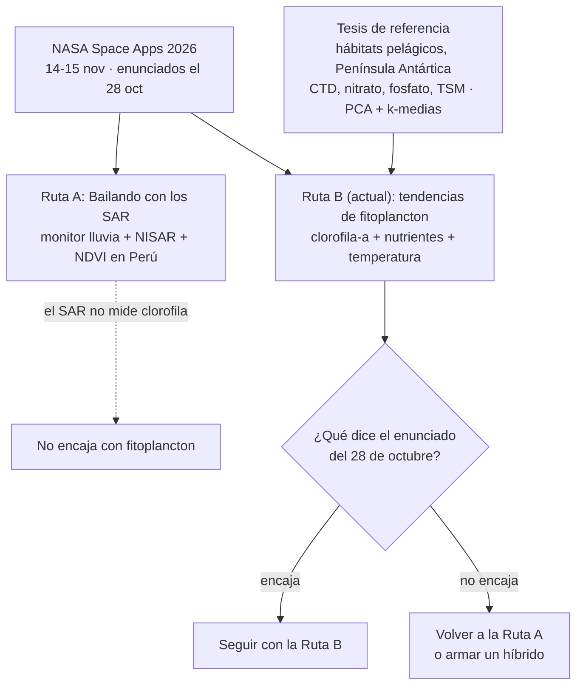
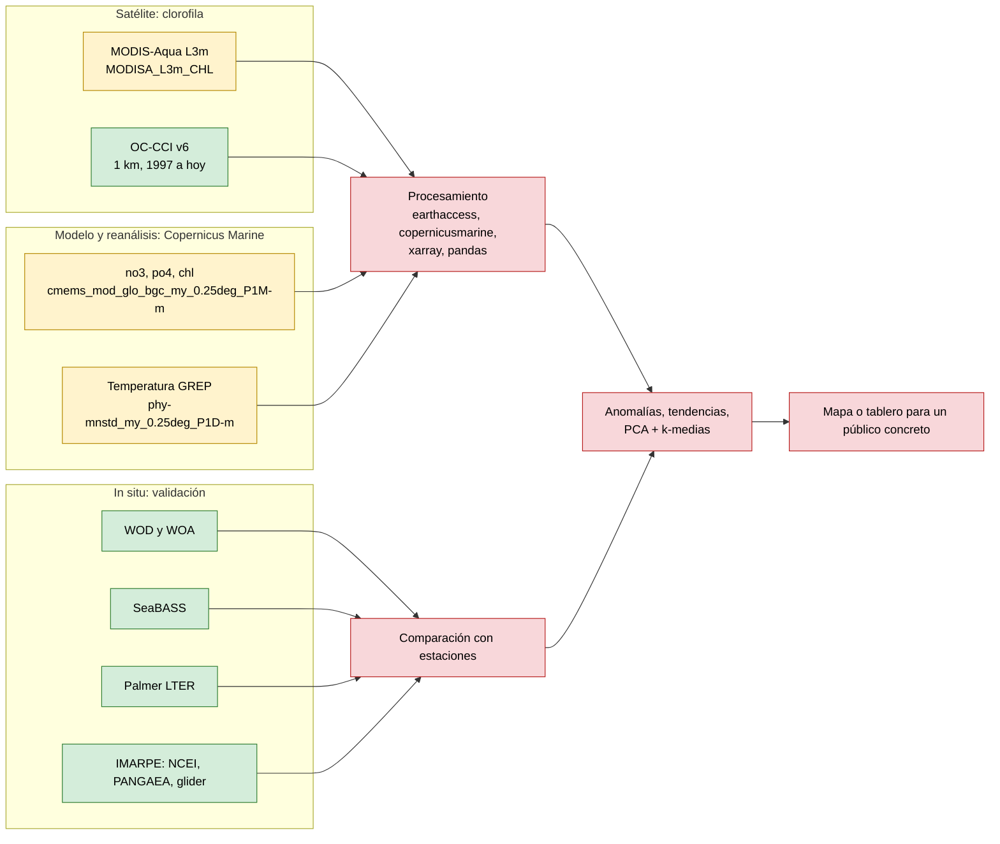
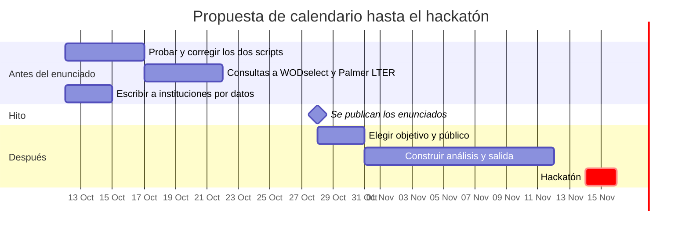

# Resumen del avance: ruta del fitoplancton (NASA Space Apps 2026)

Fecha del resumen: 12 de octubre de 2026.
Convención: lo marcado **(de memoria)** no fue verificado; lo demás salió de documentación o catálogos consultados durante la conversación. Nada de lo descargado o programado se ha ejecutado todavía.

---

## 1. Dónde estamos

El hackatón es el 14 y 15 de noviembre y los enunciados completos salen el **28 de octubre**. Empezamos con la ruta SAR (monitor lluvia + NISAR + NDVI en Perú) y ahora estamos explorando una segunda ruta, **tendencias de fitoplancton**, inspirada en la tesis que compartiste: caracterización de hábitats pelágicos de la Península Antártica con variables fisicoquímicas (CTD), nutrientes (nitrato, fosfato) y materia total suspendida (TSM), usando PCA y k-medias sobre campañas de 2023, 2024 y 2026.

Puntos clave de esta decisión:

- El fitoplancton no se mide con SAR, sino con **color del océano** (clorofila-a). Por eso esta ruta corresponde al desafío "Be an Earth System Trend Detective!", no a "Bailando con los SAR".
- No pudimos leer la página oficial del desafío (bloquea el acceso automatizado). Su descripción viene de reseñas secundarias: pide buscar cambio ambiental en datos de NASA.
- Los nutrientes no "indican presencia" de fitoplancton: son su combustible. La presencia la indica la clorofila-a; el cruce de ambos cuenta la historia (por ejemplo, nutrientes altos y clorofila baja sugiere limitación por luz o hierro **(de memoria)**).
- Los datos in situ de la tesis pertenecen a su grupo de investigación; no se asume que estén disponibles.

---

## 2. Hallazgos sobre la obtención de datos

### 2.1 Clorofila-a por satélite

| Fuente | Identificador útil | Cobertura | Acceso |
|---|---|---|---|
| NASA OBPG, MODIS-Aqua L3m | `MODISA_L3m_CHL` (y `MODISA_L3m_CHL_NRT` para lo reciente) | Mensual 4 km, 2003 a hoy | `earthaccess` |
| Mismo producto en ERDDAP (NOAA CoastWatch) | `erdMH1chlamday_R2022SQ`, `erdMH1chlamday_R2022NRT` | 2003 a hoy | URL de ERDDAP, recorta por ti |
| ESA OC-CCI v6 (multisensor) | `occci_v6_monthly_1km`, `occci_v6_daily_1km` en el ERDDAP de NOAA NEFSC | Global, 1 km, 1997 a hoy | ERDDAP; hay versiones antiguas obsoletas, usar la v6 |

Patrón de nombre de archivo mensual: `AQUA_MODIS.YYYYMMDD_YYYYMMDD.L3m.MO.CHL.chlor_a.4km.nc` (la versión casi en tiempo real añade `.NRT`).

### 2.2 Nutrientes y temperatura (modelo y reanálisis, Copernicus Marine)

- Cuenta gratuita, herramienta `copernicusmarine`. Son **salidas de modelo, no mediciones**.
- Producto operativo `GLOBAL_ANALYSISFORECAST_BGC_001_028`: nitrato, fosfato, silicato, hierro y clorofila; 1/4 de grado; cubre de 80°S a 90°N (entra la Península Antártica). Su ventana es de unos dos años.
- Datasets citados en el catálogo: `cmems_mod_glo_bgc-nut_anfc_0.25deg_P1M-m` (nutrientes) y `bgc-bio` (biología).
- Para historia larga: reanálisis `cmems_mod_glo_bgc_my_0.25deg_P1M-m` (variables `chl`, `no3`, `po4`).
- Temperatura: el producto GREP (`GLOBAL_MULTIYEAR_PHY_ENS_001_031`) no usa `thetao` a secas; trae varios miembros del ensamble. Datasets: `cmems_mod_glo_phy-mnstd_my_0.25deg_P1D-m` (media y desviación) y `cmems_mod_glo_phy-all_my_0.25deg_P1D-m`. El script detecta el nombre real de la variable.
- Operativo reciente: `cmems_mod_glo_phy-thetao_anfc_0.083deg_P1D-m`.
- Servicios tipo Open-Meteo: la API marina es gratuita para uso no comercial, pero está pensada para pronóstico a pocos días y no pudimos confirmar su cobertura antártica. No sirve para series históricas de investigación.

### 2.3 Datos in situ (para validar o comparar)

| Zona | Fuente | Qué hay | Formato / acceso |
|---|---|---|---|
| Global | World Ocean Database (NOAA) | Perfiles: temperatura, salinidad, nutrientes, clorofila | `WODselect` (CSV, netCDF); entrega por enlace al correo, sin API en tiempo real |
| Global | World Ocean Atlas | Climatologías de temperatura, salinidad, oxígeno, nitrato, fosfato, silicato | Archivos de malla; sirve como línea base |
| Global | NASA SeaBASS | Clorofila, pigmentos, temperatura, salinidad | Gratis con Earthdata Login; lectores en Python |
| Antártida (Península occidental) | Palmer LTER (`pallter-data.marine.rutgers.edu/erddap`) | CTD 1991 en adelante (`CruiseCTDProfiles`), clorofila 1991-2019 (`CruiseChlorophyll`), absorción de nitrato (`CruiseNitrateUptake`) | ERDDAP: CSV/JSON por URL |
| Antártida / Océano Austral | BCO-DMO (`bcodmo_dataset_2373`) | Nitrato, fosfato y silicato de campañas 2001-2002 | ERDDAP |
| Perú | IMARPE en NOAA NCEI (accesión 0229831) | CTD: temperatura, salinidad, oxígeno, 2006-2016 | CSV; el catálogo lo marca "no público", confirmar abriendo el DOI |
| Perú | IMARPE en PANGAEA | Botellas con nutrientes de 1996-1997 | TSV, licencia CC BY 3.0 |
| Perú | IMARPE, planeador (`callao1906_final_gridded.mat`) | Clorofila, turbidez, temperatura, salinidad, oxígeno (Callao 2019) | MATLAB `.mat` |

### 2.4 Flujo de datos propuesto

Leyenda: verde = fuente verificada en documentación; amarillo = script escrito pero **sin probar**; rojo = por construir.

### 2.5 Librerías, métodos y archivos que nos sirven

- **Acceso:** `earthaccess` (login con `persist=True`), `copernicusmarine` (`open_dataset`, `login`), ERDDAP por URL, `WODselect` y SeaBASS por web.
- **Procesamiento:** `xarray` (cubos netCDF, `sel`, `resample`, `sortby("lat")`), `netCDF4`, `pandas`, `matplotlib` (escala `LogNorm` para clorofila; usar **mediana**, no media).
- **Métodos de la tesis, reutilizables:** estandarizar variables, **PCA**, **k-medias**, número de clusters por **método del codo y coeficiente de silueta**, tablas de contingencia y chi-cuadrado para comparar años. En Python se corresponden con `scikit-learn` (`StandardScaler`, `PCA`, `KMeans`, `silhouette_score`) **(de memoria)**; la tesis usa R.
- **Scripts ya escritos (sin probar):** `ver_clorofila.py` y `ver_nutrientes_temperatura.py` (periodo por defecto 2020-2022; la variable de temperatura se detecta automáticamente).
- **Ruta SAR en pausa:** `NISAR_L2_GCOV_PROVISIONAL_V1`, lectura con `h5py`, granules de unos 1,4 GB, comparar solo misma pista, cuadro y polarización.

---

## 3. Lo que aún no tenemos y lo que podría interesarnos

### 3.1 Pendiente o no conseguido

- Leer el **enunciado oficial** (28 de octubre): ¿exige datos NASA específicos?, ¿admite datos externos como Copernicus?, ¿qué criterios de evaluación usa?
- **Probar los dos scripts** con datos reales y corregir lo que falle.
- No encontramos **TSM in situ** en repositorios abiertos; solo turbidez del planeador del IMARPE.
- No encontramos una **API abierta del IMARPE** ni nutrientes peruanos recientes; los de PANGAEA son de los años noventa.
- No confirmamos concentraciones de **nutrientes en Palmer LTER** (solo absorción de nitrato) ni la cobertura antártica de Open-Meteo.
- No definimos aún el **público** ni la decisión que informaría el producto de fitoplancton.
- No sabemos si los datos in situ de la tesis (79 estaciones) se pueden usar.
- Falta una **fuente satelital de turbidez o material suspendido** como sustituto de TSM **(de memoria: existen estimaciones por reflectancia, con limitaciones en aguas turbias)**.

### 3.2 Ideas que podrían valer la pena

- **Hábitats pelágicos desde satélite y modelo:** aplicar PCA + k-medias a mallas de clorofila, nitrato, fosfato, temperatura (y salinidad, variable a confirmar en Copernicus) por verano, y comparar la distribución de clusters entre años, como hace la tesis pero con datos abiertos y reproducibles.
- **Validación con estaciones:** comparar satélite y modelo contra SeaBASS y Palmer LTER (Península) o IMARPE (Perú). Eso le da rigor frente a proyectos que solo dibujan mapas.
- **Anomalías y tendencia:** climatología mensual por píxel y anomalía, con incertidumbre; en 20 años, la variabilidad natural (como El Niño) puede imitar una tendencia **(de memoria)**.
- **Región con usuario claro:** el mar peruano (afloramiento, El Niño, pesca) o la Península Antártica (monitoreo ambiental). Los públicos posibles (IMARPE, pesca artesanal, programas antárticos) son hipótesis a validar.
- **Manejo de limitaciones antárticas:** nubes, hielo marino y aguas turbias por deshielo degradan la clorofila satelital; enmascarar el hielo marino y marcar qué es dato medido y qué es modelo.
- **Escribir a instituciones** pidiendo estaciones con coordenadas y fecha, unidades, método, control de calidad, profundidad, formato, licencia y cómo citar.
- **Híbrido con SAR (riesgoso):** SAR para hielo o frente glaciar y color del océano para la respuesta. Primero habría que comprobar si hay granules NISAR sobre la Península (recuadro aproximado -70, -69, -55, -61).

### 3.3 Calendario propuesto (a validar)

### 3.4 Decisiones abiertas

- [ ] ¿Seguimos con la Ruta B (fitoplancton) o volvemos a la Ruta A (SAR) tras leer el enunciado?
- [ ] ¿Región: mar peruano o Península Antártica?
- [ ] ¿Qué público y qué decisión informa el producto?
- [ ] ¿Qué institución recibe el pedido de datos?
