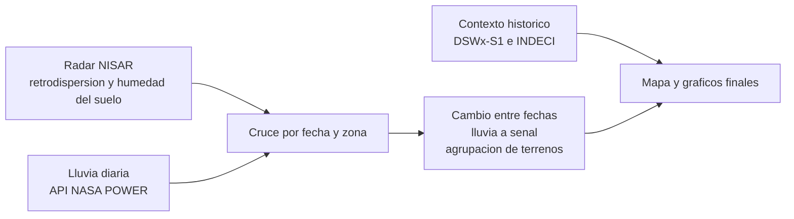
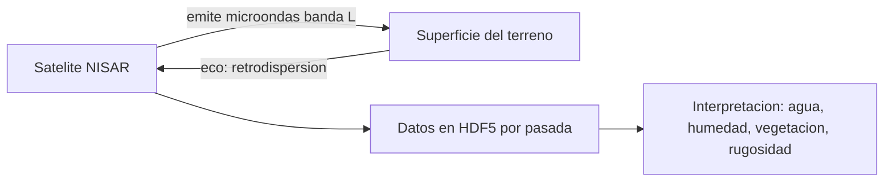
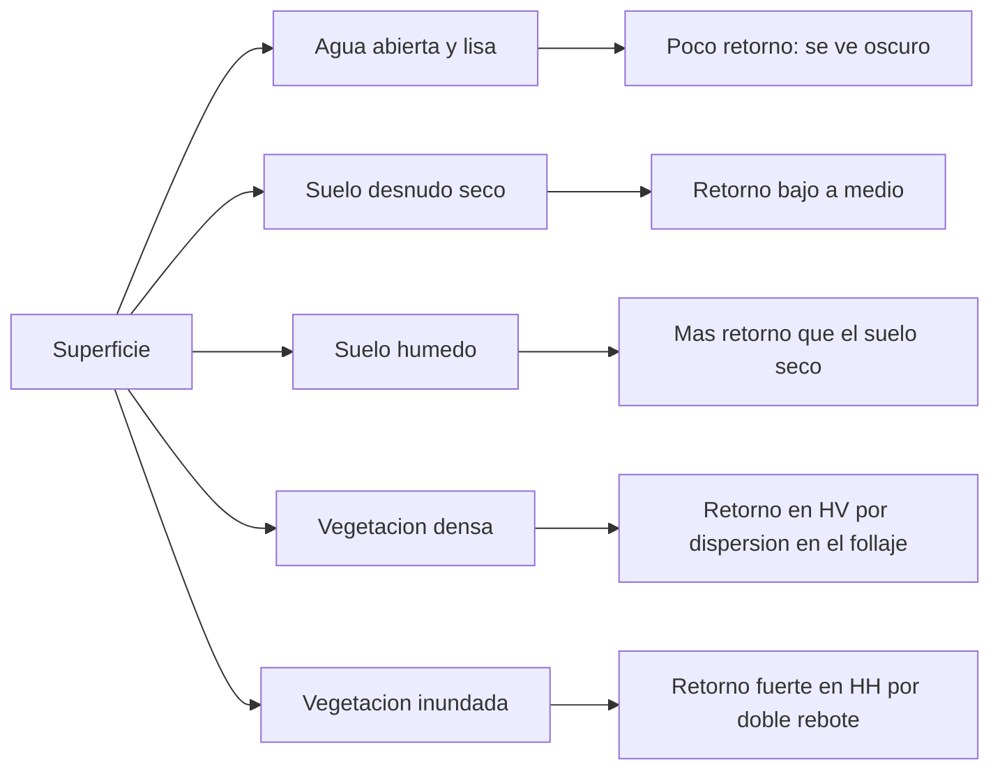
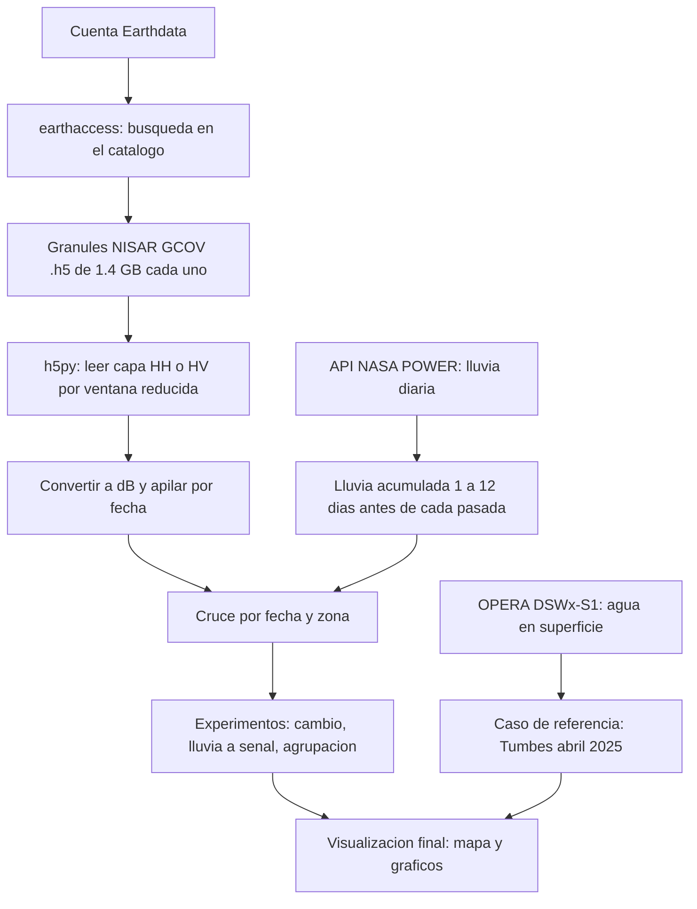
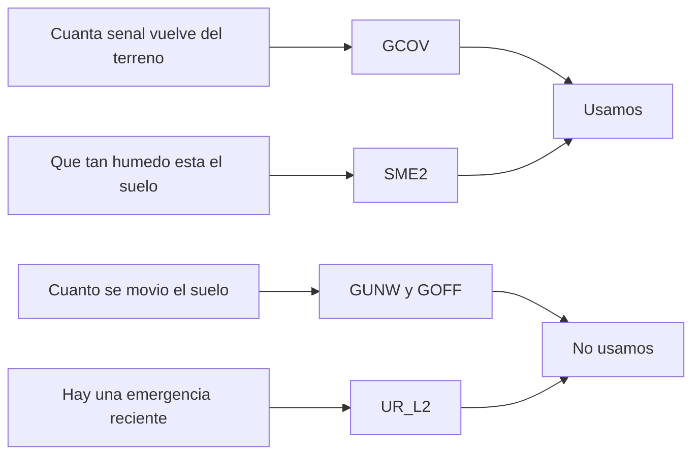
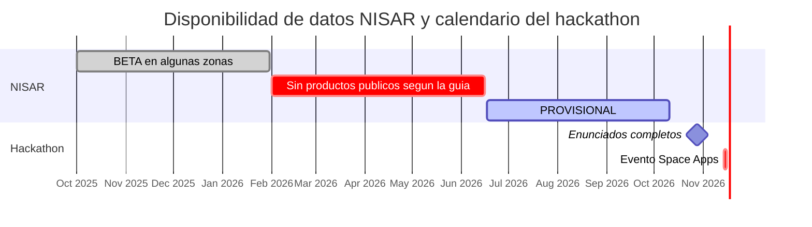
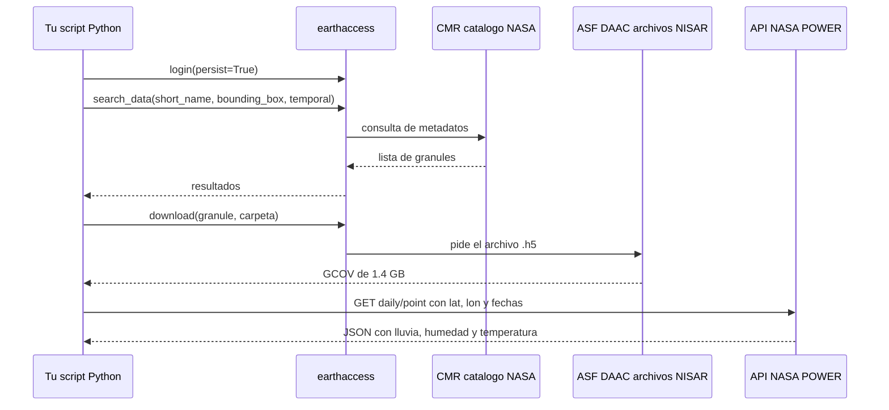
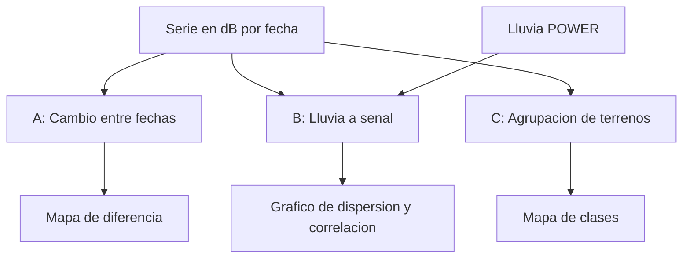

# Bailando con los SAR: guía de la idea, los nombres y las APIs

Documento de trabajo, 11 de octubre de 2026. Para ver los diagramas usa GitHub, Obsidian, VS Code con una extensión de Mermaid o https://mermaid.live.

> **Cómo leer las marcas de confianza.** En las tablas, "verificado" significa que lo comprobé en una fuente durante esta conversación o que lo viste en tu propia salida. "De memoria" significa conocimiento general que no revisé ahora. "Inferido" significa que lo deduje de los nombres de archivo y hay que confirmarlo.
>
> **Limitación importante.** No pude abrir la página oficial del desafío (el sitio bloquea el acceso automatizado). Lo que sé del desafío viene de resúmenes públicos de equipos y sedes locales. Los enunciados completos se publican el **28 de octubre**; léelos antes de comprometer el alcance.

---

## 1. Resumen en 30 segundos

- **Qué es el desafío:** usar radar de apertura sintética (SAR), sobre todo de la misión NISAR, para detectar y mostrar cambios en la superficie de la Tierra (agua, vegetación, suelo, movimiento del terreno).
- **Qué tienes ya:** acceso a NISAR sobre Perú (cientos de granules) y una serie de lluvia diaria desde la API de NASA POWER.
- **La idea propuesta:** un monitor de **respuesta del terreno**. Para una zona de Perú, cruzar lo que "ve" el radar (retrodispersión, humedad del suelo) con la lluvia acumulada, mostrar cambios entre fechas y agrupar zonas que se comportan parecido.
- **Qué NO es:** un modelo de pronóstico. Con unas 9 o 10 pasadas por pista y cuadro no hay datos suficientes para predecir. Es **monitoreo y descripción**.



---

## 2. Qué es SAR y por qué NISAR

**SAR** es un radar que va en un satélite. Emite pulsos de microondas hacia la superficie y mide el "eco" que vuelve. Como emite su propia señal, funciona de día y de noche y atraviesa las nubes.

**NISAR** es una misión conjunta de NASA e ISRO. Lo que descargas de ASF es la **banda L** (longitud de onda larga, penetra mejor el follaje). Repite sus observaciones cada **12 días** (verificado).



La cantidad de señal que vuelve (la **retrodispersión**) depende de lo que haya en el suelo. Reglas generales de SAR (de memoria):



Material de NASA sobre NISAR menciona que la banda L puede mapear inundación incluso bajo el bosque (verificado). El resto del diagrama es conocimiento general.

---

## 3. La idea del proyecto

### 3.1 Pregunta central

> ¿Cómo responde el terreno peruano (la señal de radar y la humedad del suelo) a la lluvia y a los cambios entre fechas, y qué zonas se comportan de forma parecida?

### 3.2 Alcance mínimo viable (para 48 horas)

1. **Una sola zona** y **una sola combinación** de pista, cuadro y polarización con varias fechas.
2. **Una serie temporal**: retrodispersión media (en dB) por fecha.
3. **Tres vistas**: mapa de cambio entre dos fechas, gráfico lluvia contra señal, mapa de grupos de terreno.
4. **Contexto**: el desborde de Tumbes de abril de 2025 con DSWx-S1 y el reporte de INDECI, como "así se ve una inundación".

### 3.3 Flujo de trabajo



---

## 4. Mapa de nombres: qué es cada cosa

### 4.1 Instituciones, centros y herramientas

| Nombre | Qué es | Para qué lo usas | Estado |
|---|---|---|---|
| **NASA Space Apps Challenge** | Hackathon global anual de 48 horas. En 2026: 14 y 15 de noviembre, tema "The Next Frontier" | El evento | Verificado |
| **NISAR** | Misión NASA-ISRO de radar. Mide cambios de la superficie cada 12 días | Fuente principal de datos | Verificado |
| **ISRO** | Agencia espacial de la India, socia de NISAR | Contexto | Verificado |
| **ASF DAAC** | Alaska Satellite Facility: el centro de datos de NASA que distribuye NISAR | De dónde bajas los `.h5` | Verificado |
| **Vertex** | Buscador web de ASF para ver y descargar datos sin programar | Explorar cobertura | De memoria |
| **Earthdata Login** | Tu cuenta gratuita de NASA | Autenticarte para descargar | Verificado |
| **CMR** | Catálogo de metadatos de NASA que consulta `earthaccess` | Búsqueda de granules (por detrás) | De memoria |
| **DAAC** | "Centro de archivo de datos" de NASA. Hay uno por disciplina (ASF para radar, PO.DAAC para océanos y agua, etc.) | Saber de dónde viene cada producto | De memoria |
| **earthaccess** | Librería de Python que busca y descarga datos de NASA | Todo el acceso a NISAR y DSWx-S1 | Verificado |
| **NASA POWER** | Servicio de datos meteorológicos de NASA con API REST | Lluvia, humedad, temperatura y viento diarios | Verificado |
| **OPERA** | Proyecto de NASA que procesa Sentinel-1 en productos listos para usar | DSWx-S1 (agua en superficie) | Verificado |
| **INDECI / COEN** | Defensa Civil del Perú: reportes de emergencias | Fechas y ubicación de desbordes reales | Verificado |
| **SENAMHI** | Servicio meteorológico e hidrológico del Perú | Estaciones para validar lluvia | Verificado |

### 4.2 Productos NISAR (los de tu lista)

La columna "Qué es" sale de los títulos del catálogo. "Responde a" y "Uso" son interpretación de memoria.

| `short_name`                      | Nivel | Qué es                                                                                                  | Responde a                                | Uso en esta idea                          |
| --------------------------------- | ----- | ------------------------------------------------------------------------------------------------------- | ----------------------------------------- | ----------------------------------------- |
| `NISAR_L2_GCOV_*`                 | L2    | Covarianza polarimétrica geocodificada: retrodispersión por polarización, en cuadrícula con coordenadas | Cuánta señal vuelve                       | **Principal**                             |
| `NISAR_L3_SME2_*`                 | L3    | Humedad del suelo                                                                                       | Qué tan húmedo está el suelo              | **Complemento**                           |
| `NISAR_L2_GSLC_*`                 | L2    | Imagen compleja (amplitud y fase) geocodificada                                                         | Base para interferometría propia          | No                                        |
| `NISAR_L2_GUNW_*`                 | L2    | Interferograma desenrollado geocodificado                                                               | Cuánto se movió el suelo entre dos fechas | No, salvo un sismo en la ventana de datos |
| `NISAR_L2_GOFF_*`                 | L2    | Desplazamientos de píxel geocodificados                                                                 | Movimientos grandes (glaciares, sismos)   | No                                        |
| `NISAR_L1_RSLC_*`                 | L1    | Imagen compleja en geometría radar                                                                      | Datos "crudos" geométricos                | No                                        |
| `NISAR_L1_RIFG_*`, `RUNW`, `ROFF` | L1    | Interferograma envuelto, desenrollado y offsets, en geometría radar                                     | Idem                                      | No                                        |
| `NISAR_UR_L2`                     | n/d   | Producto de "Urgent Response"                                                                           | Respuesta a emergencias                   | Revisar si hay eventos en Perú            |
| `NISAR_OE`                        | n/d   | Efemérides de órbita                                                                                    | Posición del satélite                     | No                                        |



### 4.3 Madurez de los datos: BETA y PROVISIONAL (verificado)

- **BETA**: productos anteriores a la calibración completa, de octubre de 2025 a enero de 2026 en algunas áreas. Tienen más problemas conocidos.
- **PROVISIONAL**: calibrados, publicados el 20 de julio de 2026, para todas las adquisiciones desde el **17 de junio de 2026**. Cumplen bien los requisitos en latitudes bajas, y Perú lo es.
- La guía de ASF avisa de que BETA y PROVISIONAL **no se solapan en el tiempo** y que hay que tener cuidado al combinarlos en un mismo análisis.
- El PROVISIONAL de humedad del suelo (SME2) aún **no está completamente calibrado**.
- Algunas combinaciones de pista y cuadro del PROVISIONAL en modo diagnóstico no son usables: 161/174, 161/175, 169/090 y 169/091 (se corregirá en agosto de 2026, según la guía).



### 4.4 Anatomía del nombre de un granule

Ejemplo (tu salida de Tumbes y Piura):

`NISAR_L2_PR_GCOV_023_104_A_175_2005_DHDH_A_20260621T110903_20260621T110938_P05023_N_F_J_001`

Se separa con `split("_")`. Los índices son:

| Índice | Valor | Significado | Estado |
|---|---|---|---|
| 0 | `NISAR` | Misión | Verificado |
| 1 | `L2` | Nivel de procesamiento | Verificado |
| 2 | `PR` | Sin confirmar | No verificado |
| 3 | `GCOV` | Tipo de producto | Verificado |
| 4 | `023` | Ciclo de 12 días (tus ejemplos del 17 y del 21 de junio comparten 023) | Inferido |
| 5 | `104` | Pista (track) | Inferido |
| 6 | `A` | Dirección de la órbita (A = ascendente) | Inferido |
| 7 | `175` | Cuadro (frame) | Inferido |
| 8 | `2005` | Sin confirmar (¿modo de observación?) | No verificado |
| 9 | `DHDH` o `SHSH` | Polarización: S sería simple (HH) y D dual (HH y HV) | Inferido: confirma con las capas del `.h5` |
| 10 | `A` | ¿Frecuencia o banda? | No verificado |
| 11 y 12 | `20260621T110903` y `...T110938` | Inicio y fin de la adquisición en UTC | Verificado por el formato |
| 13 | `P05023` | CRID: identificador de la versión del procesamiento PROVISIONAL | Verificado |
| 14 a 16 | `N_F_J` | Sin confirmar | No verificado |
| 17 | `001` | Contador | No verificado |

**Por qué importa:** para armar una serie temporal solo puedes comparar granules con la **misma pista, el mismo cuadro y la misma polarización**. Si no, cambia el ángulo de incidencia y los valores no son comparables.

### 4.5 Otras fuentes de datos

| Fuente | Qué entrega | Cómo se accede | Rol en la idea | Estado |
|---|---|---|---|---|
| **NASA POWER** | Series diarias: humedad relativa, lluvia, temperatura, viento. Resolución gruesa (basada en modelos) | API REST sin clave | Lluvia para cruzar con la señal | Verificado |
| **GPM IMERG** | Precipitación por satélite, mejor resolución que POWER | `earthaccess` o GES DISC | Alternativa para lluvia | De memoria |
| **OPERA DSWx-S1** | Mapa de agua en superficie a 30 m desde Sentinel-1, GeoTIFF, desde septiembre de 2024 | `earthaccess`, `rasterio` | Contexto: inundación de Tumbes de 2025 | Verificado |
| **OPERA DIST-S1** | Perturbación del suelo desde Sentinel-1, desde marzo de 2026 | `earthaccess` | Posible complemento | Verificado |
| **INDECI / COEN** | Reportes de emergencias en PDF (por ejemplo, Tumbes, 7 de abril de 2025) | Web de INDECI | Fechas reales de desbordes | Verificado |
| **SENAMHI** | Estaciones de lluvia y temperatura, con registro previo | Web de SENAMHI | Validar POWER o IMERG | Verificado |
| **G-REALM, DAHITI, Hydroweb** | Nivel del lago Titicaca por altimetría | Descarga web | Solo si eliges Titicaca | Verificado |
| **GIBS, EONET, FIRMS** | Mosaicos de imagen, eventos naturales e incendios de NASA | APIs web (FIRMS pide clave gratuita) | Mapas de fondo y contexto | De memoria |

---

## 5. APIs y funciones que llamamos



| Llamada | Qué hace | Entradas | Salida |
|---|---|---|---|
| `earthaccess.login(persist=True)` | Se autentica con tu cuenta Earthdata | Usuario y clave la primera vez | Sesión guardada |
| `earthaccess.search_datasets(keyword="NISAR")` | Lista colecciones disponibles | Palabra clave | Los `short_name` de NISAR |
| `earthaccess.search_data(...)` | Busca granules | `short_name`, `bounding_box=(oeste, sur, este, norte)`, `temporal=(inicio, fin)` | Lista de granules con metadatos |
| `earthaccess.download(lista, carpeta)` | Descarga archivos | Granules y destino | Archivos `.h5` en disco (unos 1.4 GB cada uno) |
| `earthaccess.open(lista)` | Abre archivos remotos sin bajarlos | Granules | Objetos de archivo (sin probar) |
| `h5py.File(ruta)` | Abre un HDF5 | Ruta | Árbol de grupos y capas |
| `f.visititems(...)` | Imprime la estructura | Función de impresión | Nombres reales de las capas |
| `dataset[::n, ::n]` | Lee una capa reducida | Paso de submuestreo | Matriz NumPy |
| `rasterio.open(ruta)` | Abre un GeoTIFF (DSWx-S1) | Ruta | Bandas y metadatos |

**API de NASA POWER** (verificado en su documentación):

- **Endpoint:** `https://power.larc.nasa.gov/api/temporal/daily/point`
- **Parámetros que usaste:** `parameters=RH2M,PRECTOTCORR,T2M,WS2M`, `community=AG`, `latitude`, `longitude`, `start`, `end`, `format=JSON`.
- **Qué significan (de memoria):** `RH2M` humedad relativa a 2 m (%), `PRECTOTCORR` precipitación corregida (mm/día), `T2M` temperatura a 2 m (°C), `WS2M` viento a 2 m (m/s).
- **Resultado:** `properties.parameter.<variable>.<AAAAMMDD>` con un valor por día. Los faltantes pueden venir como `-999` (de memoria): filtra siempre.
- **Cada petición devuelve un solo punto.** Para varios lugares haces un bucle.

**Zonas aproximadas que usaste:**

| Zona | Recuadro `(oeste, sur, este, norte)` | Punto POWER (lat, lon) |
|---|---|---|
| tumbes_piura | (-81.0, -5.5, -80.0, -3.3) | Tumbes (-3.57, -80.45), Piura (-5.19, -80.63) |
| titicaca | (-70.5, -17.0, -68.5, -15.0) | Puno (-15.84, -70.02) |
| ucayali | (-75.0, -9.0, -73.5, -7.0) | Pucallpa (-8.38, -74.55) |

---

## 6. Lo que ya encontraste

### 6.1 Cobertura de NISAR

| Zona | Granules PROVISIONAL | Fechas distintas | Polarización de tu ejemplo | BETA | SME2 |
|---|---|---|---|---|---|
| tumbes_piura | 57 | 22 | `DHDH` | 0 | 57 |
| titicaca | 71 | 33 | `SHSH` | 22 | 54 |
| ucayali | 61 | 17 | `SHSH` | 32 | 52 |

**Cuidado:** "fechas distintas" mezcla varias pistas y cuadros. Con la repetición de 12 días, una sola combinación de pista y cuadro tendrá unas 9 o 10 fechas entre el 17 de junio y hoy. Falta correr el agrupamiento por pista, cuadro y polarización (`agrupar()`) para saber cuántas fechas comparables tienes de verdad.

### 6.2 Lluvia diaria en POWER, del 17 de junio al 8 de octubre de 2026 (114 días)

| Punto | Días con más de 1 mm | Total (mm) |
|---|---|---|
| Tumbes | 15 | 71.4 |
| Piura | 10 | 44.7 |
| Puno | 11 | 53.4 |
| Pucallpa | 57 | 327.8 |

**Corrección a algo que dije antes.** Supuse que la ventana de junio a octubre sería casi seca en las tres zonas, y no es así. En **Pucallpa llovió más de 1 mm en la mitad de los días**, así que ahí sí hay variación de lluvia para relacionar con la señal. En Tumbes, Piura y Puno llovió poco: hay algo de señal, pero escasa. Además POWER es grueso (basado en modelos) y puede errar en lluvias ligeras: valida con IMERG o con SENAMHI.

### 6.3 Qué zona elegir

| Criterio | tumbes_piura | titicaca | ucayali |
|---|---|---|---|
| Lluvia para estudiar la respuesta | Baja | Baja a media | **Alta** |
| Polarización (ejemplo) | Dual (más información) | Simple | Simple |
| Fechas (todas las pistas) | 22 | **33** | 17 |
| Datos BETA para ampliar la serie | No | Sí | Sí |
| Tipo de terreno | Cultivos con riego, costa | Lago, totorales, altiplano | Selva y llanura inundable |
| Riesgo principal | Poca lluvia | Cambios lentos y pequeños | Pocas fechas y polarización simple |

**Mi lectura provisional (la decisión es tuya):** prueba primero **Ucayali** para el experimento lluvia→señal, porque es donde la variable explicativa más varía. Si tras agrupar por pista y cuadro quedan menos de 8 fechas comparables, cambia a **Tumbes y Piura** y apóyate en el cambio entre fechas y la agrupación, aprovechando la polarización dual.

---

## 7. Experimentos



| Experimento | Qué haces | Qué entrega | Límites |
|---|---|---|---|
| **A. Cambio entre fechas** | Restas la retrodispersión en dB de dos pasadas de la misma pista y cuadro | Mapa de diferencia | El moteado (speckle) añade ruido: promedia píxeles |
| **B. Lluvia a señal** | Calculas la señal media de una ventana por fecha y la comparas con la lluvia acumulada de 1, 3, 6 y 12 días antes | Gráfico de dispersión y correlación (por ejemplo, Spearman) | Con unas 8 a 10 fechas solo puedes **describir**, no predecir. Reporta la incertidumbre |
| **C. Agrupación** | Por píxel calculas media, desviación y rango en dB a lo largo del tiempo y aplicas k-means con k de 3 a 4 | Mapa de clases de terreno | Sin etiquetas: interpreta con una imagen de fondo (GIBS) |
| **D. Humedad del suelo contra lluvia** | Comparas SME2 con la lluvia de POWER | Gráfico | SME2 sale del propio radar y aún no está calibrado del todo. No uses SME2 como "verdad" para validar el GCOV: sería circular |
| **E. Contexto de inundación** | Muestras DSWx-S1 sobre Tumbes antes y después de abril de 2025, junto al reporte de INDECI | Mapa de agua | La tesela `T17MNR` que bajaste es casi toda sin dato (probablemente mar o fuera de la pasada): usa otras teselas con tierra |

### Esqueleto para el experimento B

```python
import h5py, numpy as np

def serie_db(rutas, capa, f0, f1, c0, c1, paso=4):
    """Media de retrodispersion en dB por fecha, en una ventana."""
    medias = []
    for r in rutas:
        with h5py.File(r) as f:
            a = f[capa][f0:f1:paso, c0:c1:paso]
        db = 10 * np.log10(np.where(a > 0, a, np.nan))
        medias.append(np.nanmean(db))
    return np.array(medias)

# capa = "<ruta de la capa HH o HV que veas en el arbol del .h5>"
# fechas = [...]  # AAAAMMDD de cada granule, en el mismo orden
# lluvia_n_dias(fecha, n) = suma de PRECTOTCORR en los n dias previos
```

La ruta de la capa y las ventanas las sacas del árbol del HDF5 (`f.visititems`) y de mirar una imagen reducida.

---

## 8. Lo que NO podemos afirmar

- **Pronóstico.** No hay suficientes fechas por píxel para predecir.
- **Causalidad.** Ver que la señal sube después de llover no demuestra que la lluvia la causó: también cambia el cultivo, el riego y la vegetación.
- **Calibración final.** Los productos PROVISIONAL aún no están totalmente validados, y SME2 menos.
- **Movimiento del terreno.** Requiere interferogramas (GUNW) y pares limpios; con la serie corta y sin un sismo en la ventana, no es el foco.
- **Lluvia exacta.** POWER es un producto de resolución gruesa.
- **Mezclar BETA y PROVISIONAL sin cuidado.** La guía de ASF pide precaución.

---

## 9. Plan y lista de tareas

**Esta semana**

1. Correr `agrupar()` por zona y elegir la combinación de pista, cuadro y polarización con más fechas.
2. Descargar **un** granule de esa combinación e imprimir su árbol con `visititems` para identificar las capas HH y HV.
3. Construir `serie_db()` sobre una ventana pequeña. Descarga 8 o 10 granules (unos 12 a 15 GB), guarda la serie en `.npy` y borra los `.h5`.
4. Bajar la lluvia de POWER para el mismo periodo y calcular acumulados de 1, 3, 6 y 12 días.
5. Repetir el recorte de DSWx-S1 con teselas que sí tengan tierra en Tumbes.

**Antes del 28 de octubre**

- Esperar los enunciados completos y comprobar: (a) qué datos y recursos recomienda el desafío, (b) si exige NISAR o acepta Sentinel-1 como apoyo, (c) qué se puede preparar antes del evento. Una sede local indica que empezar el proyecto antes puede descalificar: confirma en las reglas oficiales.

**14 y 15 de noviembre**

- Ejecutar los experimentos, armar la visualización y preparar la narrativa en torno a una pregunta clara.

---

## 10. Glosario rápido

| Término | Significado |
|---|---|
| **SAR** | Radar de apertura sintética: radar de imagen en un satélite |
| **Retrodispersión (backscatter)** | Parte de la señal emitida que vuelve al sensor |
| **dB** | Escala logarítmica para expresar la retrodispersión: `10 * log10(valor)` |
| **Polarización (HH, HV)** | Orientación de la onda emitida y recibida. HH: horizontal-horizontal. HV: horizontal-vertical, sensible al follaje |
| **Moteado (speckle)** | Ruido granular propio del radar. Se reduce promediando |
| **Ascendente / descendente** | Sentido de la órbita al pasar sobre la zona |
| **Pista y cuadro (track, frame)** | Trayectoria repetida del satélite y el segmento de esa trayectoria. Necesarios para comparar fechas |
| **Ángulo de incidencia** | Inclinación con que el radar mira el terreno. Cambia el valor medido |
| **Interferograma** | Diferencia de fase entre dos pasadas. Sirve para medir movimiento del suelo |
| **Geocodificado** | Ya ubicado en una cuadrícula de coordenadas |
| **Granule** | Un archivo (o conjunto de archivos) de datos con su metadato |
| **CRID** | Identificador de la versión del procesamiento (por ejemplo, P05023) |
| **HDF5** | Formato de archivo con grupos y capas anidadas, que se abre con `h5py` |
| **GeoTIFF** | Imagen georreferenciada, que se abre con `rasterio` |
